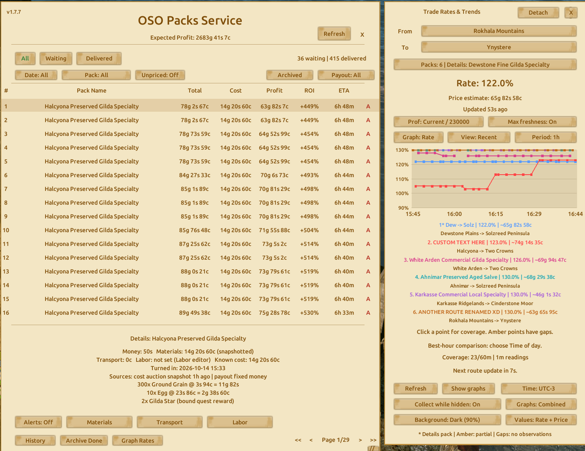

# OSO Packs Service

A lightweight ArcheRage addon that tracks your trade pack sales and tells you exactly how much profit you made on each one.

## What it does

- To see percentage and money together, use **Values: Rate + Price** in Rates. This changes graph labels while keeping your selected plot metric. Alternatively, cycle **Graph** to **Both**: solid lines show payout percentage against the left axis, and dashed lines show estimated gross price against the right gold axis. These options work with full, separate, and combined graphs and survive restarts. Price uses your selected Commerce/freshness assumptions and is an estimate; missing prices never hide an available percentage line. Use **...** on a floating graph to access these controls.
- Customize each floating chart with **//** (drag the bottom-right handle to resize), **Text** (detailed/compact/hidden pack rows and custom names), and **Aa** (12/14/10 point text). Width and plot height change independently. With **Values: Rate + Price** or **Graph: Both**, the price has its own line below each pack, even in compact mode; the background grows vertically to fit. Rate-only compact legends use one line per pack. **Text > Hide pack names and prices** removes these rows and reduces the window height. **Text > Customize route labels** replaces the entire pack/origin/destination text with your custom label; a blank label restores the original text. Wider charts show longer names; narrow charts shorten text. These preferences are saved separately per route and for the combined chart, retaining up to 12 recently positioned routes with active selections first. Resizing keeps the graph in place and redraws existing observations immediately.
- Click **Color** at the bottom-left of a floating graph to choose a preset or enter a custom **#RRGGBB** color. In the combined graph, choose the pack/route first. The choice follows that route's line, normal markers, price overlay, and combined legend and survives restarts; **Automatic pack color** restores its default. Amber partial-coverage markers keep their meaning.
- Floating rate graphs offer **Transparent**, **Shaded (50%)**, and **Dark (90%)** backgrounds. Use **Graph background** in the Rates controls or **BG** on any floating graph to cycle the shared, saved choice. Backgrounds stay behind the graph and remain click-through. Drag a graph's title to position it freely; dropping, refreshing, and reopening preserve its position at the current UI scale. A graph may extend beyond screen edges as long as its title remains reachable.
- Rates dropdowns include **Close** (or **Done** for pack selection). Clicking the same selector again also dismisses its menu without changing the selected value. Menu backgrounds are opaque and raised over graph labels, including when new readings arrive.
- Logs every pack you sell with its total payout, material, transport, and labor costs, and net profit
- Pulls live material prices from the auction house automatically
- Calculates ROI and lets you sort the ledger by any column
- Shows an eight-hour ETA countdown until the game's payment arrives
- Separates Waiting and automatically Delivered packs
- Displays all-time history, daily totals that survive archiving rows, top packs, and paged trade-run history
- Saves each turn-in immediately and refreshes closed windows when you open them, reducing work during deliveries

## Controls

- Drag the **///** handle at the ledger’s lower-right corner to show more packs or widen the columns. The ledger starts at 660 pixels wide and twelve rows, supports up to 990 pixels wide and eight to twenty-four rows when the screen has room, and remembers both dimensions. Wider settings show more of each pack name, including full names that fit the column. Page buttons still browse the full list.
- **Date**, **Pack**, **Payout**, and **Unpriced** buttons narrow the ledger. **Pack** opens a wider dropdown that shows complete names from saved packs; choose **All packs** to clear it, and use Prev/Next when the list spans pages. The Pack button stays its original width and shortens the selected name. Date and Payout cycle choices when clicked; payout choices are derived from saved records.
- **Transport**, **Labor**, and **Materials** open separate editors. Select a ledger row first; its pack type opens in the editor. Confirm the full pack name in the dropdown before saving. Settings apply to all saved records of that type and future sales. Transport has quantities and per-item gold/silver/copper prices for Eco-Friendly Fuel and Axle Grease. Each **AUTO** toggle uses the auction-house price for that item and keeps the entered price as a fallback when no auction result is available. Enter the labor points used for a pack and click **Save**; Labor compares fixed-amount Worker's Compensation and Labor Reward items on the auction house and uses the cheapest price per restored labor point. The editor shows the chosen item and has a **Refresh prices** button. The addon cannot detect labor spent, and labor cost stays unpriced until a suitable auction price is known. Details reports when labor points have not been set for the selected pack or when an auction price is still needed. Materials shows recipe items with editable quantities and per-item prices, including individual **AUTO** toggles; packs without a known recipe offer a manual total. Total cost, Profit, ROI, and History include all three costs when priced.
- **Alerts** enables or disables a chat notice when a saved Waiting pack reaches its eight-hour delivery time. It is off by default and does not announce old Delivered rows when the addon starts.
- **Refresh** queues new auction estimates and preserves requests already in progress. Lookups continue even with the ledger and OPS control hidden; there is no 25-item cutoff. Missing ledger quotes are queued before configured-item refreshes. Searches keep a two-second gap and retry failures up to three times with backoff, while allowing other items to proceed. Turn-ins start pricing after a short fixed batching delay, and unfinished prices are checked again on entering the world. Lookups pause during loading. Details shows the source and age of a saved price. AUTO transport and material rules, plus labor rates, refresh when their auction results arrive; completed material and payout snapshots keep their recorded values. An item without a valid auction listing or usable sale information remains unpriced; use Refresh to try again later.
- **A** archives a row; switch to **Archived** and click **R** to restore it. The footer **Archive Done** archives all Delivered rows, and **Restore All** in Archived reverses a bulk archive.
- **Graph Rates** opens the route-rate side panel. Use **From** and **To** to browse a route, then open **Pack** to add packs from it. The addon requests one route at a time, at least 30 seconds apart, respecting any longer cooldown returned by the game. It cycles through the selected routes while a rate view is visible; packs sharing a route share its request. More routes therefore take longer to complete a refresh cycle, and each graph shows its own reading age. An independent timer and response listener keep working when the ledger or OPS launcher is hidden. Prices use the same server-specific Commerce and freshness formula as Folio105. **Detach** lets it stay open after closing the ledger. Drag the header, unused background, or noninteractive text to move it; dragging also detaches a docked panel and remembers its position. Buttons, dropdowns, and chart points keep their normal click actions. Choose **Dock** to attach it again.
- The Rates **Pack** list lets you tick up to **six pack-and-route entries**, keeping at least one selected. Existing selections appear first, followed by available packs for the route being browsed. Each row shows the full pack name and its origin/destination; click **Done** when finished. Change **From/To** to add packs from another region without clearing previous selections. The same pack delivered to two destinations counts as two independent entries. Selections, focused details, and per-route graph positions are remembered across restarts. The full panel shows all selected entries as colored lines and route legends on one shared scale. A pack with no readings or incomplete prices/costs keeps an explicit status without hiding the others. Click a legend's pack name or a point to choose the **details pack**, marked with `*`; its headline, coverage, and best-hour text update. Missing rows in a server reply retain their selection and last reading with its original age.
- **Collect while hidden** is off by default. Turn it on to keep cycling through the selected routes while logged in, even after closing Rates and the separate or combined graphs. It remembers the setting across restarts, respects the same server cooldown, and retries if route information is temporarily unavailable during login. Hidden collection skips chart redraws and Commerce/cost calculations. Turn the setting off to return to collecting only while a rate view is visible; existing queued saves still finish. It cannot collect while the game is closed.
- Choose **Graphs: Separate / Combined**, then click **Show graphs**. Separate opens a transparent mini-graph for each selected pack and route; drag each title independently. Combined opens one transparent graph containing all selected entries as colored lines on a shared scale, with a legend showing each pack, route, value, and reading age. On the combined Rate graph, the latest payout percentage for each selected pack appears at the line's right edge in that series' color; a `*` marks stale readings. Both layouts default to a transparent background, offer optional shaded or dark backdrops through BG, and remember their positions across restarts. Each separate graph has its own scale, quote, coverage, and missing-data message. All graphs share the period, metric, timezone, and Commerce/freshness settings; each entry keeps its own route and destination-specific payout. Use **...** to return to the full controls. A separate graph's **x** removes that entry; closing the last graph closes Rates and retains the last selection. The combined graph's **x** closes Rates while retaining all entries. A missing reply times out after 15 seconds; manual Refresh also clears an expired request before retrying.
- Rate graphs show labeled horizontal payout brackets, normally **90%, 100%, 110%, 120%, and 130%**. The scale expands when observations fall below or above that range, using wider intervals when necessary to keep labels readable. Price and Profit show labeled money intervals. These lines are scale guides; they do not fill missing observations.
- **Prof** selects current Commerce (the default, including bonus points), OFF, or fixed values of 272,000 / 332,000. The server multiplier is `1 + (Commerce / 10000 × 0.05)`: 272,000 gives ×2.36; 332,000 gives ×2.66. Current Commerce refreshes at most once every five seconds while the panel is visible. If it cannot be read, prices explicitly wait for Commerce data; fixed modes remain available.
- **Max freshness** starts OFF. Turn it ON to estimate the maximum freshness bonus used by Folio105: Luxury ×1.30, Fine ×1.15, Commercial ×1.05, Preserved ×1.03, or ×1.30 for Heedmar deliveries. This is a selectable assumption; the panel does not detect the age of a carried pack. Both price settings are saved and recalculate immediately.
- **Graph: Rate / Price / Profit** cycles between payout percentage, estimated gross payout, and estimated net profit. Price uses the selected Commerce and freshness settings and rounds down to whole copper as in Folio105. Packs without a reference payout price show no money estimate. **View: Recent / Time of day** switches between a chronological chart and averages grouped by the hour of the day. **Time** in the bottom row selects the displayed timezone (defaults to UTC-3). Click a point in the full panel for its value and sample coverage.
- **Profit** subtracts the current materials, transport, and labor estimate for that exact pack type. Set these in the ledger's **Materials**, **Transport**, and **Labor** editors. Material recipes/presets can supply the material component; transport and labor must have explicit saved settings, including zero amounts if appropriate. Required AUTO prices without an auction quote or positive manual fallback remain incomplete, and no net-profit point is shown until all costs are known. Negative profit is displayed below the grey **0g break-even line**. The panel marks cached costs when quotes are stale. Historical Price/Profit points apply today's selected payout modifiers and current cost assumptions to recorded rates; they are estimates, not historical realized profit. Reading graph costs does not modify sales or launch auction searches.
- If a money graph cannot be calculated, its plot explains why instead of appearing blank. **Show rate graph** displays the recorded payout percentages for the same selected period; it does not assume unknown costs are zero. In the transparent view, use **...** to open these controls. Changing Period always updates the axis and coverage, even if missing costs prevent Profit points from being drawn. Loading and periods with no recorded observations also have explicit messages inside the plot.
- **Period** opens a dropdown. Recent presets are **15m, 30m, 1h, 2h, 3h, 6h, 12h, 24h, 48h, 7d, 14d, and 30d**; use Next/Prev for more choices, or **Custom** for any whole number from **1 to 720 hours**. Time of day offers **3, 7, 14, or 30 days**, plus a custom lookback of **1 to 30 days**. Each view remembers its own period (initially 24 hours and 30 days), including after a restart. Separate and combined graphs use the same period; click the displayed period (such as **2h**) on a floating graph to change it directly.
- **15m, 30m, and 1h** use actual minute readings, with up to 60 points. The current UTC hour and previous two hours are saved in three reusable small slots per pack/route. Minute history starts with new observations after this update; old hourly averages are never expanded into invented minute points. Lines connect actual readings across the expected route polling interval, with a small allowance for timing differences. Dots and coverage still represent actual observations; longer gaps remain unconnected. Longer recent views use hourly history with at most 30 points: 48 hours uses 2-hour averages, 7 days uses 6-hour averages, and 30 days uses 24-hour averages. Each observed hour has equal weight. Changing the display period does not change the server refresh interval.
- **Coverage** shows observed minutes/hours against the selected period in both views. **Amber points** mark partially observed intervals; click one for details such as `6/24h observed`. Empty intervals remain empty and partial intervals break the line. Longer views use date labels. Ordinary partial-day play can therefore leave isolated points in a long-period chart; those points still show the average of the observations actually collected.
- Rate history records all returned packs for each requested route, at most once per minute per pack and route. Storage is separate from the ledger, with verified small saves spread across updates. Long-period charts cover up to 30 days; retention includes the partial UTC day needed at the beginning of that window, and older stored days are pruned when that pack is tracked again. Offline gaps, time between polling turns for different routes, and closed-panel gaps when background collection is off remain empty. Each observed day has equal weight in the time-of-day graph. **Best observed hour** uses the selected period and appears after at least two different hours each have observations on three days; it describes collected rates, not a forecast or guaranteed best time.
- Rate replies from the game do not always include route IDs. The panel ignores unsolicited replies and observes calls from the existing Pack Ratio tracker when its query function is available. Replies for a selected or browsed route can update this panel too. Conflicting requests are rejected; pause the other tracker to let this panel cycle all its routes. A missing response retains the last reading with its original age. Readings are marked stale after at least 90 seconds, allowing longer for multiple routes and the server cooldown. A successful refresh does not necessarily move the line when rates are unchanged, or add another saved point within the same minute.
- A trade run groups consecutive turn-ins separated by at most 30 minutes. History shows four runs per page; use **<** and **>** to browse all retained runs. New run summaries are saved in verified chunks. Runs older than the former twelve-run limit can be recovered only when their records still exist in the ledger.

## Installation

1. Download the latest release
2. Extract the folder into your ArcheRage addons directory
3. Enable **OPS** in the in-game addon manager and restart the game client
