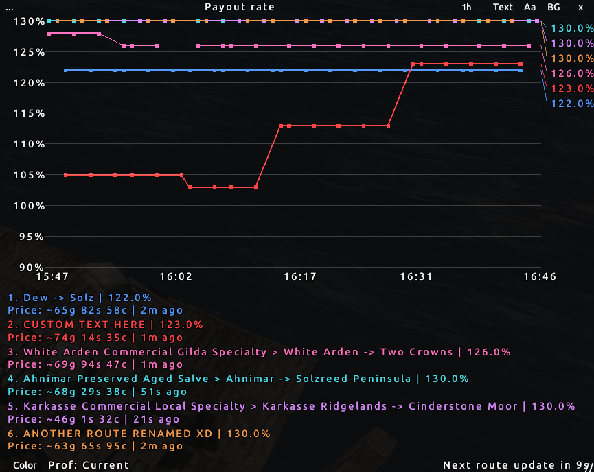

# OSO Packs Service — v1.8.0

Track tradepack sales, costs, profit, and payout rates on ArcheRage.

## Features and quick controls

- **Improved ledger:** Filter and sort sales, view ROI, and resize the window to show more packs and longer names.
- **Custom costs:** Set materials, fuel, grease, and labor costs for each pack using manual or auction prices.
- **Expanded history:** Browse trade runs and daily/all-time profit summaries, with saved price and cost snapshots.
- **Rates and trends:** Open **Graph Rates** to track payout rates, estimated prices, and profit over time or by hour of the day. Normal polling gaps connect automatically.
- **Compare packs:** Select up to six packs across different routes. Choose **Graphs: Separate / Combined**, then **Show graphs**.
- **Resizable graphs:** Drag the title to move a graph and **//** to resize it. Smaller percentage marks appear as the graph gets taller.
- **Graph appearance:** Use **Color**, **BG**, and **Aa** to change series colors, background, and text size. Click the displayed period to change it.
- **Less text:** Open **Text → Hide pack names and prices** for a smaller graph, or choose Detailed/Compact to show the rows again.
- **Custom route labels:** Open **Text → Customize route labels…**, choose a pack/route, and enter your text. Leave it blank to restore the original label.
- **Current status:** Each line shows its latest percentage on the right. The footer shows the Commerce mode and next-update countdown.

## Installation

1. Download the [latest release](https://github.com/P-Raphael/OSO-TradePack-Ledger/releases/latest).
2. Extract the addon into your ArcheRage addons directory.
3. Enable **OPS** in the addon manager and restart the game client.

See the [usage guide](GUIDE.md) for detailed instructions and the [changelog](CHANGELOG.md) for version history.
